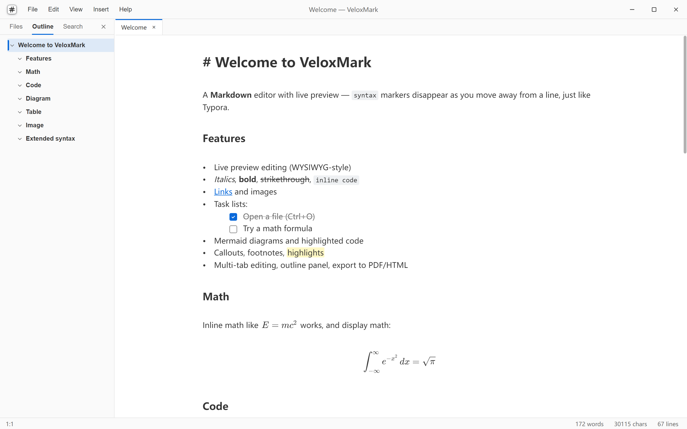

<p align="center">
  
</p>

<h1 align="center">VeloxMark</h1>

<p align="center"><b>Write in Markdown — everything else is decoration.</b></p>

<p align="center">
  <a href="LICENSE"></a>
  <a href="https://github.com/biao-biao-ls/veloxmark/releases/latest"></a>
  
</p>

**English** | [简体中文](docs/readme/zh.md) | [日本語](docs/readme/ja.md) | [한국어](docs/readme/ko.md) | [Español](docs/readme/es.md) | [Português](docs/readme/pt.md) | [Français](docs/readme/fr.md) | [Deutsch](docs/readme/de.md) | [Русский](docs/readme/ru.md)

VeloxMark is a free, open-source Markdown reader and editor for the desktop with live preview. It aims for the frictionless writing feel popularized by [Typora](https://typora.io) while keeping plain `.md` files fully portable — Markdown source is the only data source, so saving always writes clean Markdown with zero round-trip loss. Built on Electron and CodeMirror 6, for macOS, Windows and Linux.



- Website & documentation: https://veloxmark.knzn.net
- Downloads: https://github.com/biao-biao-ls/veloxmark/releases

## Features

- **Live preview (Typora-style)**: syntax markers hide when the cursor leaves a line and it renders in its final style; the caret line always stays in source form
- **Block rendering**: code blocks with syntax highlighting, KaTeX math and Mermaid diagrams — click any block to edit its source
- **Extended syntax**: callouts, footnotes, `==highlights==`, superscript/subscript and front matter
- **Tables**: native editing with nested cell editors, insert/convert dialogs, column resize and alignment
- **Outline navigation**: heading tree in the sidebar with click-to-jump and current-position highlighting
- **Multi-tab editing**: several files at once, close/reopen tabs, unsaved changes marked with `•`
- **Focus modes**: focus mode, typewriter mode and raw source mode
- **Light/dark theme**: switch from the View menu (Toggle Theme), remembered across sessions; the frameless title bar and in-app menus follow along
- **Export**: PDF and HTML, including selection-only HTML export
- **Typing assists**: wrap bare URLs on paste, convert pasted HTML to Markdown
- **Task lists**: `- [ ]` renders as a clickable checkbox
- **Images**: absolute, relative and remote paths, with `=WxH` sizing and align/flip attributes
- **Auto-update**: installers check GitHub Releases and update in place (Windows NSIS and Linux AppImage)
- **Localization**: English, Chinese, Japanese, Korean, Spanish, Portuguese, French, German and Russian UI (including native menus and sample documents)

## Install

Download the build for your platform from the [releases page](https://github.com/biao-biao-ls/veloxmark/releases/latest):

- **Windows** — NSIS installer (with auto-update) or portable zip
- **macOS** — dmg and zip (unsigned builds). On first launch, right-click → **Open**, or strip the quarantine flag: `xattr -d com.apple.quarantine /Applications/VeloxMark.app`
- **Linux** — AppImage (with auto-update), deb, rpm, tar.gz or snap

## Development

```bash
npm install
npm run dev          # development mode (hot reload)
npm run build        # build to out/
npm run typecheck    # tsc --noEmit, run before committing
npm run build:win    # package — also build:mac, build:linux
```

> If Electron binary downloads fail on restricted networks:
> `ELECTRON_MIRROR=https://npmmirror.com/mirrors/electron/ npm install`

## Tech stack

- [Electron](https://www.electronjs.org) + [electron-vite](https://electron-vite.org) + React + TypeScript
- [CodeMirror 6](https://codemirror.net) — editor core; live preview via StateField decorations
- [KaTeX](https://katex.org) — math
- [mermaid](https://mermaid.js.org) — diagrams
- [highlight.js](https://highlightjs.org) — code highlighting

## Architecture

```
electron/               main process: windows, native menus, file dialogs,
                        mdres:// image protocol, auto-update routing
electron/preload.ts     contextBridge-safe IPC API
src/renderer/src/
  App.tsx               shell: title bar, sidebar, file/theme state
  editor/livePreview/   live-preview core (StateField decoration engine)
  editor/widgets.ts     code/math/mermaid/image/task widgets
  editor/setup.ts       CodeMirror extension assembly, keybindings
  editor/theme.ts       light/dark themes (CM6 theme + CSS variables)
  outline/extract.ts    heading outline extraction from the syntax tree
  i18n/                 UI dictionaries (en/zh/ja/ko/es/pt/fr/de/ru)
```

The decoration engine rebuilds Decorations on every document and selection change: markers are hidden with replace decorations, rendered blocks are swapped for widgets, and entering a range skips its decorations so the source form returns. See [CLAUDE.md](CLAUDE.md) for the full architecture notes.

## Documentation

Full user documentation lives on the [website](https://veloxmark.knzn.net/docs/). The release runbook (process, artifacts, signing status, troubleshooting) is in [CLAUDE.md](CLAUDE.md) under "Release process".

## Contributing

- **Commit messages and code comments must be written in English.**
- **Translations belong only in the localization packs** — one pack (file or directory) per language:
  - `src/renderer/src/i18n/<lang>.ts` — UI dictionary and language self-names
  - `electron/shared/menuStrings/<lang>.ts` — native menu strings
  - `src/renderer/src/content/<lang>.ts` — welcome/help documents
  - `src/renderer/src/editor/mermaidTemplates/<lang>.ts` — Mermaid template bodies
  - `docs/readme/<lang>.md` — translations of this README
  - `website/docs/<lang>/` and `website/docs/.vitepress/locales/<lang>.ts` — website pages and website UI strings

  Everything else in the repository stays English-only.

## License

[MIT](LICENSE)
