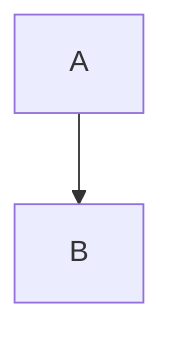

# Markdown-Syntax

VeloxMark rendert [CommonMark](https://commonmark.org) und GitHub Flavored Markdown, dazu
eine Reihe erweiterter Konstrukte — Formeln, Diagramme, Callouts, Fußnoten und Hervorhebungen. Jeder
Abschnitt unten zeigt die Quelle; tippe sie ein und sieh, wie sie direkt gerendert wird.

## Überschriften

Mit `#` voranstellen (1–6 Rauten). Die Überschriftenebene wird die Gliederungsebene in der Seitenleiste.

````markdown
# H1
## H2
### H3
````

## Betonung

````markdown
**fett**  *kursiv*  ~~durchgestrichen~~  `Inline-Code`
````

## Listen

````markdown
- ungeordneter Eintrag
1. geordneter Eintrag

- [ ] Aufgabe
- [x] erledigt
````

Aufgabenlisten werden als anklickbare Kontrollkästchen gerendert — Klick schaltet den `[ ]` / `[x]`-Marker in
der Quelle um, ohne ihn zu sehen.

## Zitat & Trennlinie

````markdown
> zitierter Text

---
````

## Callouts

Callouts im GitHub-Stil verwandeln ein Blockzitat, dessen erste Zeile `[!TYP]` ist, in einen gestalteten
Hinweis:

````markdown
> [!TIP]
> Klicke ein Diagramm, eine Formel oder einen Codeblock an, um seine Quelle zu bearbeiten.
````

Unterstützte Typen: `note`, `tip`, `important`, `warning`, `caution`, `info`, `success`,
`danger`. Setze `-` hinter den Typ, um eingeklappt zu starten, `+` für ausgeklappt, und einen
optionalen Titel hinter den Typ:

````markdown
> [!WARNING]- Optionaler Titel
> Textkörper.
````

## Mathematik (KaTeX)

Inline-Formeln nutzen einfache Dollarzeichen; Blockformeln stehen mit doppelten Dollarzeichen in eigenen Zeilen:

````markdown
Inline: $a^2 + b^2 = c^2$

Display:
$$
\frac{1}{2}
$$
````

Klicke eine gerenderte Formel an, um ihre Quelle zu bearbeiten.

## Diagramme (Mermaid)

Umschließe einen Block mit `mermaid` und er wird direkt gerendert:

````markdown

````

Klicke das gerenderte Diagramm an, um in seine umschlossene Quelle zurückzukehren.

## Codeblöcke

Umschlossene Codeblöcke erhalten Syntaxhervorhebung (highlight.js):

````markdown
```typescript
function greet(name: string): string {
  return `Hello, ${name}!`
}
```
````

## Tabellen

````markdown
| Funktion | Status | Notizen |
| :------ | :----: | ----: |
| Live-Vorschau | ✓ | Typora-Stil |
| Mathematik | ✓ | KaTeX |
````

Die Ausrichtung steuert die Trennzeile (`:---`, `:--:`, `---:`). Tabellen werden als echte
bearbeitbare Raster gerendert — siehe [Bearbeiten im Detail](./editing#tabellen).

## Links & Bilder

````markdown
[Text](https://example.com)

````

Bilder können absolute Pfade, Pfade relativ zur aktuellen `.md`-Datei oder Remote-URLs sein.
Ein optionales Größen-Suffix setzt die Anzeigeabmessungen:

````markdown

````

Details unter [Bilder](./images).

## Fußnoten

````markdown
Fußnoten[^1] springen zu ihrer Definition.

[^1]: Wie diese hier.
````

## Hervorhebungen

````markdown
==hervorgehobener Text==
````

## Hochgestellt, tiefgestellt & Abkürzungen

````markdown
2^10^ = 1024  und  H~2~O

*[HTML]: Hyper Text Markup Language

HTML ist oben abgekürzt; jede Verwendung zeigt einen Tooltip.
````

## Front Matter

YAML-Front-Matter zwischen führenden `---`-Zäunen wird erkannt; `title`, `date` und `tags`
werden in einem eingeklappten Widget in der Live-Vorschau zusammengefasst, und `title` wird beim
Export zur Dokument-H1:

````markdown
---
title: Mein Dokument
date: 2026-10-21
tags: [markdown, veloxmark]
---
````

## Maskieren

Maskiere jedes Markdown-Satzzeichen mit einem Backslash, um es wörtlich zu schreiben: `\*nicht kursiv\*`.
