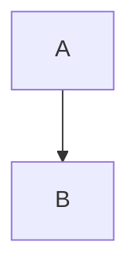

# Markdown syntax

VeloxMark renders [CommonMark](https://commonmark.org) and GitHub Flavored Markdown, plus
a set of extended constructs — math, diagrams, callouts, footnotes and highlights. Each
section below shows the source; type it and watch it render in place.

## Headings

Prefix with `#` (1–6 hashes). The heading level becomes the outline level in the sidebar.

````markdown
# H1
## H2
### H3
````

## Emphasis

````markdown
**bold**  *italic*  ~~strikethrough~~  `inline code`
````

## Lists

````markdown
- unordered item
1. ordered item

- [ ] task
- [x] done
````

Task lists render as clickable checkboxes — click to toggle the `[ ]` / `[x]` marker in
the source without seeing it.

## Quote & divider

````markdown
> quoted text

---
````

## Callouts

GitHub-style callouts turn a blockquote whose first line is `[!TYPE]` into a styled
admonition:

````markdown
> [!TIP]
> Click a diagram, formula, or code block to edit its source.
````

Supported types: `note`, `tip`, `important`, `warning`, `caution`, `info`, `success`,
`danger`. Add `-` after the type to start collapsed, `+` to start expanded, and an
optional title after the type:

````markdown
> [!WARNING]- Optional title
> Body text.
````

## Math (KaTeX)

Inline math uses single dollars; display math uses double dollars on their own lines:

````markdown
inline: $a^2 + b^2 = c^2$

display:
$$
\frac{1}{2}
$$
````

Click any rendered formula to edit its source.

## Diagrams (Mermaid)

Fence a block with `mermaid` and it renders in place:

````markdown

````

Click the rendered diagram to drop back into its fenced source.

## Code blocks

Fenced code blocks get syntax highlighting (highlight.js):

````markdown
```typescript
function greet(name: string): string {
  return `Hello, ${name}!`
}
```
````

## Tables

````markdown
| Feature | Status | Notes |
| :------ | :----: | ----: |
| Live preview | ✓ | Typora-style |
| Math | ✓ | KaTeX |
````

Alignment is driven by the separator row (`:---`, `:--:`, `---:`). Tables render as real
editable grids — see [Editing in depth](./editing#tables).

## Links & images

````markdown
[text](https://example.com)

````

Images can be absolute paths, paths relative to the current `.md` file, or remote URLs.
An optional size suffix sets the display dimensions:

````markdown

````

See [Images](./images) for details.

## Footnotes

````markdown
Footnotes[^1] jump to their definition.

[^1]: Like this one.
````

## Highlights

````markdown
==highlighted text==
````

## Superscript, subscript & abbreviations

````markdown
2^10^ = 1024  and  H~2~O

*[HTML]: Hyper Text Markup Language

HTML is abbreviated above; every use shows a tooltip.
````

## Front matter

YAML front matter between leading `---` fences is recognized; `title`, `date` and `tags`
are summarized in a collapsed widget in live preview, and `title` becomes the document
H1 in exports:

````markdown
---
title: My document
date: 2026-10-21
tags: [markdown, veloxmark]
---
````

## Escaping

Backslash-escape any Markdown punctuation to write it literally: `\*not italic\*`.
