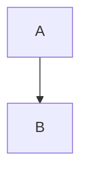

# Sintaxis de Markdown

VeloxMark renderiza [CommonMark](https://commonmark.org) y GitHub Flavored Markdown, más
un conjunto de construcciones extendidas — fórmulas, diagramas, notas destacadas, notas al
pie y resaltado. Cada sección de abajo muestra el código fuente; escríbelo y míralo
renderizarse en el lugar.

## Títulos

Prefija con `#` (de 1 a 6 almohadillas). El nivel del título se convierte en el nivel del
esquema en la barra lateral.

````markdown
# H1
## H2
### H3
````

## Énfasis

````markdown
**negrita**  *cursiva*  ~~tachado~~  `código en línea`
````

## Listas

````markdown
- elemento sin orden
1. elemento ordenado

- [ ] tarea
- [x] hecha
````

Las listas de tareas se renderizan como casillas clicable — haz clic para alternar el
marcador `[ ]` / `[x]` en el código fuente sin tener que verlo.

## Cita y separador

````markdown
> texto citado

---
````

## Notas destacadas

Las notas destacadas estilo GitHub convierten una cita cuya primera línea es `[!TYPE]`
en una admonición con estilo:

````markdown
> [!TIP]
> Haz clic en un diagrama, una fórmula o un bloque de código para editar su código fuente.
````

Tipos admitidos: `note`, `tip`, `important`, `warning`, `caution`, `info`, `success`,
`danger`. Añade `-` después del tipo para empezar plegado, `+` para empezar desplegado, y
un título opcional después del tipo:

````markdown
> [!WARNING]- Título opcional
> Texto del cuerpo.
````

## Matemáticas (KaTeX)

Las fórmulas en línea usan un solo signo de dólar; las de bloque usan dos signos de dólar
en sus propias líneas:

````markdown
en línea: $a^2 + b^2 = c^2$

de bloque:
$$
\frac{1}{2}
$$
````

Haz clic en cualquier fórmula renderizada para editar su código fuente.

## Diagramas (Mermaid)

Encierra un bloque con `mermaid` y se renderiza en el lugar:

````markdown

````

Haz clic en el diagrama renderizado para volver a su código fuente entre vallas.

## Bloques de código

Los bloques de código entre vallas obtienen resaltado de sintaxis (highlight.js):

````markdown
```typescript
function greet(name: string): string {
  return `Hello, ${name}!`
}
```
````

## Tablas

````markdown
| Función | Estado | Notas |
| :------ | :----: | ----: |
| Vista previa en vivo | ✓ | Estilo Typora |
| Matemáticas | ✓ | KaTeX |
````

La alineación se rige por la fila separadora (`:---`, `:--:`, `---:`). Las tablas se
renderizan como cuadrículas reales y editables — consulta
[Edición en profundidad](./editing#tablas).

## Enlaces e imágenes

````markdown
[texto](https://example.com)

````

Las imágenes pueden ser rutas absolutas, rutas relativas al archivo `.md` actual o URL
remotas. Un sufijo de tamaño opcional fija las dimensiones de visualización:

````markdown

````

Consulta [Imágenes](./images) para más detalles.

## Notas al pie

````markdown
Las notas al pie[^1] saltan a su definición.

[^1]: Como esta.
````

## Resaltado

````markdown
==texto resaltado==
````

## Superíndice, subíndice y abreviaturas

````markdown
2^10^ = 1024  y  H~2~O

*[HTML]: Hyper Text Markup Language

HTML se abrevia arriba; cada uso muestra una descripción emergente.
````

## Front matter

Se reconoce el front matter YAML entre las vallas `---` iniciales; `title`, `date` y
`tags` se resumen en un componente plegado en la vista previa en vivo, y `title` se
convierte en el H1 del documento en las exportaciones:

````markdown
---
title: Mi documento
date: 2026-10-21
tags: [markdown, veloxmark]
---
````

## Escape

Escapa con barra invertida cualquier puntuación de Markdown para escribirla de forma
literal: `\*no es cursiva\*`.
