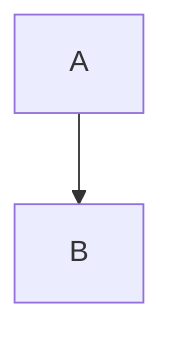

# Syntaxe Markdown

VeloxMark rend [CommonMark](https://commonmark.org) et GitHub Flavored Markdown, plus un
ensemble de constructions étendues — formules, diagrammes, encadrés, notes de bas de page
et surlignages. Chaque section ci-dessous montre la source ; tapez-la et regardez-la se
rendre sur place.

## Titres

Préfixez avec `#` (1 à 6 dièses). Le niveau du titre devient le niveau de sommaire dans
la barre latérale.

````markdown
# H1
## H2
### H3
````

## Emphase

````markdown
**gras**  *italique*  ~~barré~~  `code en ligne`
````

## Listes

````markdown
- élément non ordonné
1. élément ordonné

- [ ] tâche
- [x] terminé
````

Les listes de tâches se rendent comme des cases à cocher cliquables — cliquez pour basculer
le marqueur `[ ]` / `[x]` dans la source sans le voir.

## Citation et séparateur

````markdown
> texte cité

---
````

## Encadrés

Les encadrés style GitHub transforment un bloc de citation dont la première ligne est
`[!TYPE]` en une admonition stylée :

````markdown
> [!TIP]
> Cliquez sur un diagramme, une formule ou un bloc de code pour éditer sa source.
````

Types pris en charge : `note`, `tip`, `important`, `warning`, `caution`, `info`,
`success`, `danger`. Ajoutez `-` après le type pour commencer replié, `+` pour commencer
déplié, et un titre optionnel après le type :

````markdown
> [!WARNING]- Titre optionnel
> Texte du corps.
````

## Formules (KaTeX)

Les formules en ligne utilisent un seul dollar ; les formules hors ligne utilisent deux
dollars sur leur propre ligne :

````markdown
en ligne : $a^2 + b^2 = c^2$

hors ligne :
$$
\frac{1}{2}
$$
````

Cliquez sur n'importe quelle formule rendue pour éditer sa source.

## Diagrammes (Mermaid)

Délimitez un bloc avec `mermaid` et il se rend sur place :

````markdown

````

Cliquez sur le diagramme rendu pour revenir à sa source balisée.

## Blocs de code

Les blocs de code balisés obtiennent la coloration syntaxique (highlight.js) :

````markdown
```typescript
function greet(name: string): string {
  return `Hello, ${name}!`
}
```
````

## Tableaux

````markdown
| Fonctionnalité | État | Remarques |
| :------ | :----: | ----: |
| Aperçu en direct | ✓ | Style Typora |
| Formules | ✓ | KaTeX |
````

L'alignement est piloté par la ligne de séparation (`:---`, `:--:`, `---:`). Les tableaux
se rendent comme de vraies grilles éditables — voir
[Édition en profondeur](./editing#tableaux).

## Liens et images

````markdown
[texte](https://example.com)

````

Les images peuvent être des chemins absolus, des chemins relatifs au fichier `.md`
courant, ou des URL distantes. Un suffixe de taille optionnel fixe les dimensions
d'affichage :

````markdown

````

Voir [Images](./images) pour les détails.

## Notes de bas de page

````markdown
Les notes de bas de page[^1] sautent vers leur définition.

[^1]: Comme celle-ci.
````

## Surlignages

````markdown
==texte surligné==
````

## Exposant, indice et abréviations

````markdown
2^10^ = 1024  et  H~2~O

*[HTML]: Hyper Text Markup Language

HTML est abrégé ci-dessus ; chaque occurrence montre une infobulle.
````

## Front matter

Le front matter YAML entre les clôtures `---` initiales est reconnu ; `title`, `date` et
`tags` sont résumés dans un composant replié de l'aperçu en direct, et `title` devient le
H1 du document à l'export :

````markdown
---
title: Mon document
date: 2026-10-21
tags: [markdown, veloxmark]
---
````

## Échappement

Échappez n'importe quelle ponctuation Markdown avec une barre oblique inverse pour
l'écrire littéralement : `\*pas italique\*`.
