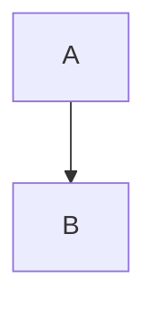

# Markdown 構文

VeloxMark は [CommonMark](https://commonmark.org) と GitHub Flavored Markdown、そして
拡張構文——数式、図表、コールアウト、脚注、ハイライト——を描画します。以下の各節に
ソースを示します。入力して、その場で描画されるのを見届けてください。

## 見出し

`#` を前置します（1–6 個のシャープ）。見出しレベルはサイドバーのアウトラインレベルに
なります。

````markdown
# H1
## H2
### H3
````

## 強調

````markdown
**太字**  *斜体*  ~~取り消し線~~  `インラインコード`
````

## リスト

````markdown
- 箇条書き項目
1. 番号付き項目

- [ ] タスク
- [x] 完了
````

タスクリストはクリックできるチェックボックスとして描画されます——クリックすると、
ソースの `[ ]` / `[x]` マークが見えないまま切り替わります。

## 引用と区切り線

````markdown
> 引用テキスト

---
````

## コールアウト

GitHub スタイルのコールアウトは、1 行目が `[!TYPE]` の引用ブロックをスタイル付きの
注意ブロックに変えます：

````markdown
> [!TIP]
> 図、数式、コードブロックをクリックするとソースを編集できます。
````

対応する型：`note`、`tip`、`important`、`warning`、`caution`、`info`、`success`、
`danger`。型の後に `-` を付けると折りたたみで開始、`+` を付けると展開で開始、型の後に
任意のタイトルを付けられます：

````markdown
> [!WARNING]- 任意のタイトル
> 本文です。
````

## 数式（KaTeX）

インライン数式は単一のドル記号、ブロック数式は独立した行の二重ドル記号を使います：

````markdown
インライン：$a^2 + b^2 = c^2$

ブロック：
$$
\frac{1}{2}
$$
````

描画された数式をクリックするとソースを編集できます。

## 図表（Mermaid）

ブロックを `mermaid` でフェンスするとその場で描画されます：

````markdown

````

描画された図表をクリックするとフェンスされたソースに戻れます。

## コードブロック

フェンスされたコードブロックにはシンタックスハイライト（highlight.js）が付きます：

````markdown
```typescript
function greet(name: string): string {
  return `Hello, ${name}!`
}
```
````

## テーブル

````markdown
| 機能 | 状態 | 備考 |
| :------ | :----: | ----: |
| ライブプレビュー | ✓ | Typora スタイル |
| 数式 | ✓ | KaTeX |
````

配置は区切り行（`:---`、`:--:`、`---:`）で決まります。テーブルは実際に編集できる
グリッドとして描画されます——[編集の詳細](./editing#テーブル) を参照。

## リンクと画像

````markdown
[テキスト](https://example.com)

````

画像は絶対パス、現在の `.md` ファイルからの相対パス、リモート URL のいずれでも構いません。
任意のサイズ接尾辞で表示寸法を設定できます：

````markdown

````

詳細は[画像](./images) を参照。

## 脚注

````markdown
脚注[^1]は定義へジャンプします。

[^1]: この脚注のように。
````

## ハイライト

````markdown
==ハイライトテキスト==
````

## 上付き、下付き、略語

````markdown
2^10^ = 1024  および  H~2~O

*[HTML]: Hyper Text Markup Language

上では HTML が略語として扱われ、使用するたびにツールチップが表示されます。
````

## フロントマター

先頭の `---` フェンスの間の YAML フロントマターは認識されます。`title`、`date`、`tags` は
ライブプレビューでは折りたたみ可能なウィジェットにまとめられ、`title` は書き出し時に
ドキュメントの H1 になります：

````markdown
---
title: 私のドキュメント
date: 2026-10-21
tags: [markdown, veloxmark]
---
````

## エスケープ

Markdown の任意の区切り文字をバックスラッシュでエスケープすると、そのように出力されます：
`\*斜体ではありません\*`。
