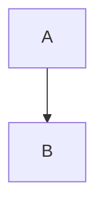

# Markdown 문법

VeloxMark는 [CommonMark](https://commonmark.org)와 GitHub Flavored Markdown, 그리고
수식, 다이어그램, 콜아웃, 각주, 강조 같은 확장 구성 요소를 렌더링합니다. 아래 각 절에는
소스가 나와 있습니다. 입력해 보고 제자리에서 렌더링되는 것을 확인하세요.

## 제목

`#` 접두사(1–6개의 해시)를 사용합니다. 제목 수준은 사이드바 개요의 수준이 됩니다.

````markdown
# H1
## H2
### H3
````

## 강조

````markdown
**굵게**  *기울임*  ~~취소선~~  `인라인 코드`
````

## 목록

````markdown
- 순서 없는 항목
1. 순서 있는 항목

- [ ] 할 일
- [x] 완료
````

작업 목록은 클릭 가능한 체크박스로 렌더링됩니다 — `[ ]` / `[x]` 마커를 보지 않고도
클릭하여 소스에서 전환합니다.

## 인용 및 구분선

````markdown
> 인용한 텍스트

---
````

## 콜아웃

GitHub 스타일 콜아웃은 첫 줄이 `[!TYPE]`인 블록 인용을 서식 있는 알림 상자로 바꿉니다:

````markdown
> [!TIP]
> 다이어그램, 수식 또는 코드 블록을 클릭하면 그 소스를 편집할 수 있습니다.
````

지원되는 유형: `note`, `tip`, `important`, `warning`, `caution`, `info`, `success`,
`danger`. 유형 뒤에 `-`를 붙이면 접힌 채로 시작하고, `+`를 붙이면 펼친 채로 시작하며,
유형 뒤에 선택적 제목을 붙일 수 있습니다:

````markdown
> [!WARNING]- 선택적 제목
> 본문 내용.
````

## 수식 (KaTeX)

인라인 수식은 단일 달러 기호를, 디스플레이 수식은 각 줄을 차지하는 이중 달러 기호를
사용합니다:

````markdown
인라인: $a^2 + b^2 = c^2$

디스플레이:
$$
\frac{1}{2}
$$
````

렌더링된 수식을 클릭하면 그 소스를 편집할 수 있습니다.

## 다이어그램 (Mermaid)

`mermaid`로 블록을 펜스하면 제자리에서 렌더링됩니다:

````markdown

````

렌더링된 다이어그램을 클릭하면 펜스 소스로 돌아갑니다.

## 코드 블록

펜스 코드 블록은 구문 강조(highlight.js)를 받습니다:

````markdown
```typescript
function greet(name: string): string {
  return `Hello, ${name}!`
}
```
````

## 테이블

````markdown
| 기능 | 상태 | 비고 |
| :------ | :----: | ----: |
| 실시간 미리보기 | ✓ | Typora 스타일 |
| 수식 | ✓ | KaTeX |
````

정렬은 구분 행(`:---`, `:--:`, `---:`)이 결정합니다. 테이블은 진짜로 편집 가능한
그리드로 렌더링됩니다 — [편집 심화](./editing#테이블)를 보세요.

## 링크 및 이미지

````markdown
[텍스트](https://example.com)

````

이미지는 절대 경로, 현재 `.md` 파일 기준 상대 경로 또는 원격 URL일 수 있습니다.
선택적 크기 접미사로 표시 크기를 지정합니다:

````markdown

````

자세한 내용은 [이미지](./images)를 보세요.

## 각주

````markdown
각주[^1]는 정의로 이동합니다.

[^1]: 이 각주처럼요.
````

## 강조

````markdown
==강조된 텍스트==
````

## 위 첨자, 아래 첨자 및 약어

````markdown
2^10^ = 1024  그리고  H~2~O

*[HTML]: Hyper Text Markup Language

HTML이 위에서 약어 처리되었습니다. 사용할 때마다 도구 설명이 표시됩니다.
````

## 프론트 매터

앞쪽 `---` 펜스 사이의 YAML 프론트 매터가 인식됩니다. `title`, `date`, `tags`는
실시간 미리보기에서 접힌 위젯으로 요약되고, `title`은 내보내기에서 문서의 H1이 됩니다:

````markdown
---
title: 내 문서
date: 2026-10-21
tags: [markdown, veloxmark]
---
````

## 이스케이프

역슬래시로 모든 Markdown 문구를 이스케이프하면 그대로 입력됩니다: `\*기울임 아님\*`.
