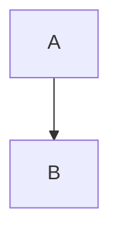

# Sintaxe Markdown

O VeloxMark renderiza [CommonMark](https://commonmark.org) e GitHub Flavored Markdown, mais
um conjunto de construtos estendidos — fórmulas, diagramas, alertas, notas de rodapé e
destaques. Cada seção abaixo mostra o código-fonte; escreva-o e veja-o ser renderizado no
local.

## Títulos

Prefixe com `#` (1–6 cerquilhas). O nível do título torna-se o nível da estrutura na barra
lateral.

````markdown
# H1
## H2
### H3
````

## Ênfase

````markdown
**negrito**  *itálico*  ~~tachado~~  `código em linha`
````

## Listas

````markdown
- item não ordenado
1. item ordenado

- [ ] tarefa
- [x] concluída
````

As listas de tarefas são renderizadas como caixas de seleção clicáveis — clique para
alternar o marcador `[ ]` / `[x]` no código-fonte sem o ver.

## Citação e divisor

````markdown
> texto citado

---
````

## Alertas

Os alertas ao estilo do GitHub transformam uma citação cuja primeira linha é `[!TYPE]` num
destaque estilizado:

````markdown
> [!TIP]
> Clique num diagrama, fórmula ou bloco de código para editar o seu código-fonte.
````

Tipos suportados: `note`, `tip`, `important`, `warning`, `caution`, `info`, `success`,
`danger`. Adicione `-` após o tipo para começar recolhido, `+` para começar expandido, e um
título opcional após o tipo:

````markdown
> [!WARNING]- Título opcional
> Texto do corpo.
````

## Matemática (KaTeX)

A matemática em linha usa um único cifrão; a matemática em bloco usa cifrões duplos em
linhas próprias:

````markdown
em linha: $a^2 + b^2 = c^2$

em bloco:
$$
\frac{1}{2}
$$
````

Clique em qualquer fórmula renderizada para editar o seu código-fonte.

## Diagramas (Mermaid)

Delimite um bloco com `mermaid` e ele é renderizado no local:

````markdown

````

Clique no diagrama renderizado para voltar ao seu código-fonte delimitado.

## Blocos de código

Os blocos de código delimitados recebem realce de sintaxe (highlight.js):

````markdown
```typescript
function greet(name: string): string {
  return `Hello, ${name}!`
}
```
````

## Tabelas

````markdown
| Função | Estado | Notas |
| :------ | :----: | ----: |
| Pré-visualização em tempo real | ✓ | Estilo Typora |
| Matemática | ✓ | KaTeX |
````

O alinhamento é definido pela linha separadora (`:---`, `:--:`, `---:`). As tabelas são
renderizadas como grades reais e editáveis — consulte
[Edição aprofundada](./editing#tabelas).

## Links e imagens

````markdown
[texto](https://example.com)

````

As imagens podem ser caminhos absolutos, caminhos relativos ao arquivo `.md` atual, ou URLs
remotos. Um sufixo de tamanho opcional define as dimensões de exibição:

````markdown

````

Consulte [Imagens](./images) para mais detalhes.

## Notas de rodapé

````markdown
As notas de rodapé[^1] saltam para a definição.

[^1]: Como esta.
````

## Destaques

````markdown
==texto destacado==
````

## Sobrescrito, subscrito e abreviações

````markdown
2^10^ = 1024  e  H~2~O

*[HTML]: Hyper Text Markup Language

HTML é abreviado acima; cada uso mostra uma dica de ferramenta.
````

## Front matter

O front matter YAML entre delimitadores `---` iniciais é reconhecido; `title`, `date` e `tags`
são resumidos num componente recolhido na pré-visualização em tempo real, e `title` torna-se
o H1 do documento nas exportações:

````markdown
---
title: O meu documento
date: 2026-10-21
tags: [markdown, veloxmark]
---
````

## Escape

Escape qualquer pontuação Markdown com barra invertida para a escrever literalmente:
`\*não itálico\*`.
