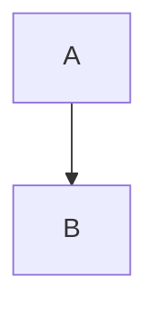

# Синтаксис Markdown

VeloxMark рендерит [CommonMark](https://commonmark.org) и GitHub Flavored Markdown,
плюс набор расширенных конструкций — формулы, диаграммы, выноски, сноски и подсветку.
Каждый раздел ниже показывает исходный код; введите его — и посмотрите, как он
рендерится на месте.

## Заголовки

Ставьте префикс `#` (от 1 до 6 решёток). Уровень заголовка становится уровнем
структуры в боковой панели.

````markdown
# H1
## H2
### H3
````

## Выделение

````markdown
**жирный**  *курсив*  ~~зачёркнутый~~  `строчный код`
````

## Списки

````markdown
- элемент без нумерации
1. элемент с нумерацией

- [ ] задача
- [x] выполнено
````

Списки задач рендерятся как щёлкаемые флажки — щёлкните, чтобы переключить маркер
`[ ]` / `[x]` в исходном коде, не видя его.

## Цитата и разделитель

````markdown
> цитируемый текст

---
````

## Выноски

Выноски в стиле GitHub превращают блок цитаты, первая строка которого — `[!TYPE]`,
в стилизованное примечание:

````markdown
> [!TIP]
> Щёлкните по диаграмме, формуле или блоку кода, чтобы отредактировать его исходный код.
````

Поддерживаемые типы: `note`, `tip`, `important`, `warning`, `caution`, `info`,
`success`, `danger`. Добавьте `-` после типа, чтобы выноска была свёрнута, `+` — чтобы
быть развёрнутой, и необязательный заголовок после типа:

````markdown
> [!WARNING]- Необязательный заголовок
> Текст основного содержания.
````

## Математика (KaTeX)

Внутристрочные формулы используют одинарные знаки доллара; блочные — двойные знаки
доллара на отдельных строках:

````markdown
строчная: $a^2 + b^2 = c^2$

блочная:
$$
\frac{1}{2}
$$
````

Щёлкните по любой отрендеренной формуле, чтобы отредактировать её исходный код.

## Диаграммы (Mermaid)

Огородите блок меткой `mermaid` — и он отрендерится на месте:

````markdown

````

Щёлкните по отрендеренной диаграмме, чтобы вернуться к её исходному коду в рамках.

## Блоки кода

Блоки кода в рамках получают подсветку синтаксиса (highlight.js):

````markdown
```typescript
function greet(name: string): string {
  return `Hello, ${name}!`
}
```
````

## Таблицы

````markdown
| Возможность | Статус | Примечания |
| :------ | :----: | ----: |
| Живой предпросмотр | ✓ | В стиле Typora |
| Формулы | ✓ | KaTeX |
````

Выравнивание задаётся строкой-разделителем (`:---`, `:--:`, `---:`). Таблицы рендерятся
как настоящие редактируемые сетки — см. [Подробнее о редактировании](./editing#таблицы).

## Ссылки и изображения

````markdown
[текст](https://example.com)

````

Изображения могут быть абсолютными путями, путями относительно текущего `.md`-файла
или удалёнными URL. Необязательный суффикс размера задаёт отображаемые размеры:

````markdown

````

См. [Изображения](./images) для подробностей.

## Сноски

````markdown
Сноски[^1] ведут к своему определению.

[^1]: Как эта.
````

## Подсветка

````markdown
==подсвеченный текст==
````

## Верхний индекс, нижний индекс и аббревиатуры

````markdown
2^10^ = 1024  и  H~2~O

*[HTML]: Hyper Text Markup Language

HTML сокращён выше; при каждом использовании показывается подсказка.
````

## Метаданные

YAML-метаданные между начальными ограничителями `---` распознаются; `title`, `date` и
`tags` сводятся в свёрнутый виджет в живом предпросмотре, а `title` становится
заголовком H1 документа при экспорте:

````markdown
---
title: Мой документ
date: 2026-10-21
tags: [markdown, veloxmark]
---
````

## Экранирование

Экранируйте обратным слэшем любой знак пунктуации Markdown, чтобы записать его
буквально: `\*не курсив\*`.
