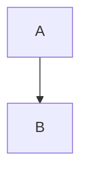

# Markdown 语法

VeloxMark 渲染 [CommonMark](https://commonmark.org) 与 GitHub Flavored Markdown，
外加一组扩展构造——公式、图表、提示块、脚注与高亮。下面每节都给出源码；
输入后即可就地渲染。

## 标题

用 `#` 前缀（1–6 个井号）。标题层级就是侧栏大纲中的层级。

````markdown
# H1
## H2
### H3
````

## 强调

````markdown
**粗体**  *斜体*  ~~删除线~~  `行内代码`
````

## 列表

````markdown
- 无序项
1. 有序项

- [ ] 待办
- [x] 已完成
````

任务列表渲染为可点击的复选框——点击即可切换源码中的 `[ ]` / `[x]` 标记，而你不必看见它。

## 引用与分隔线

````markdown
> 引用文本

---
````

## 提示块

首行为 `[!TYPE]` 的引用块会变成带样式的提示框：

````markdown
> [!TIP]
> 点击图表、公式或代码块即可编辑其源码。
````

支持的类型：`note`、`tip`、`important`、`warning`、`caution`、`info`、`success`、
`danger`。类型后加 `-` 默认折叠，加 `+` 默认展开，类型后可跟可选标题：

````markdown
> [!WARNING]- 可选标题
> 正文内容。
````

## 数学公式（KaTeX）

行内公式用单美元符号；块级公式用独占行的双美元符号：

````markdown
行内：$a^2 + b^2 = c^2$

块级：
$$
\frac{1}{2}
$$
````

点击任意渲染的公式即可编辑其源码。

## 图表（Mermaid）

用 `mermaid` 围栏一个块即可就地渲染：

````markdown

````

点击渲染出的图表即可回到围栏源码。

## 代码块

围栏代码块获得语法高亮（highlight.js）：

````markdown
```typescript
function greet(name: string): string {
  return `Hello, ${name}!`
}
```
````

## 表格

````markdown
| 功能 | 状态 | 备注 |
| :------ | :----: | ----: |
| 实时预览 | ✓ | Typora 风格 |
| 公式 | ✓ | KaTeX |
````

对齐由分隔行决定（`:---`、`:--:`、`---:`）。表格渲染为真实可编辑的网格——
见[深入编辑](./editing#表格)。

## 链接与图片

````markdown
[文本](https://example.com)

````

图片可以是绝对路径、相对当前 `.md` 文件的路径，或远程 URL。
可选的尺寸后缀设定显示尺寸：

````markdown

````

详见[图片](./images)。

## 脚注

````markdown
脚注[^1]跳转到定义处。

[^1]: 就像这条。
````

## 高亮

````markdown
==高亮文本==
````

## 上标、下标与缩写

````markdown
2^10^ = 1024  以及  H~2~O

*[HTML]: Hyper Text Markup Language

HTML 在上面被缩写；每次出现都会显示工具提示。
````

## 前置元数据

起始 `---` 围栏之间的 YAML 前置元数据会被识别；`title`、`date` 与 `tags`
在实时预览中汇总为可折叠组件，`title` 在导出时成为文档 H1：

````markdown
---
title: 我的文档
date: 2026-10-21
tags: [markdown, veloxmark]
---
````

## 转义

反斜杠转义任意 Markdown 标点即可原样输出：`\*不是斜体\*`。
